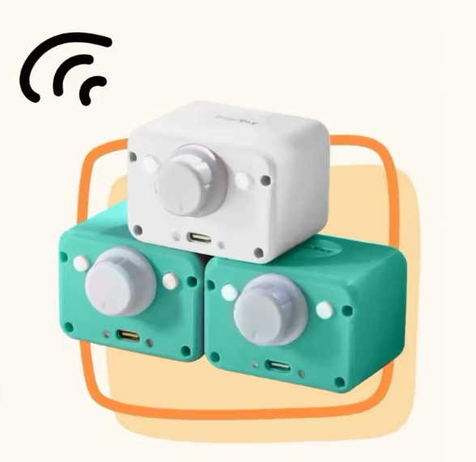

> 当前为 `demo/xiaozhi` 分支，在 main 的 BSP 基础上加入 M09 小智移植。[小智构建与验证说明](docs/XIAOZHI.md)。

# MagicBox 多代硬件 BSP

<p align="center">
  
</p>

[English](README.md) · [架构与版本规则](docs/ARCHITECTURE.md) · [验证记录](docs/VALIDATION.md)

按“型号 + 芯片 + PCB 版本”选择硬件。同为 S3 不代表引脚、电源或器件相同，不做自动猜板。

| 配置 ID | 硬件 | SDK | 状态 |
|---|---|---|---|
| `m09-s3-hw210` | M09 / ESP32-S3 / HW2.1.0 | ESP-IDF 6.1 | 用户确认型号；原始固件使用 Arduino |
| `c5-reference-m301-hw120` | ESP32-C5 / 原配置 M301 / HW1.2.0 | ESP-IDF 5.5.3 | 具体产品型号待用户确认，保留参考标识 |

- `main`：BSP、最小入口、独立硬件诊断示例。
- `demo/xiaozhi` 分支：继承 main，加入小智应用。目前 M09 移植有历史实机记录；不把 C5 BSP 编译通过标成 C5 小智已适配。
- `legacy/m09-arduino`：保留原 Arduino BSP/最小示例/硬件 Demo；共享 M09 引脚定义。新 ESP-IDF BSP 与 Arduino 是两个实现，不能把旧的实机通过记录当作新 BSP 已刷机验收。

```sh
python3 tools/build.py --list
source /path/to/esp-idf-v6.1/export.sh
python tools/build.py --board m09-s3-hw210 --app baseline
python tools/build.py --board m09-s3-hw210 --app hardware-demo
# C5 需另启 ESP-IDF 5.5.3 环境后构建：
python tools/build.py --board c5-reference-m301-hw120 --app baseline
python tools/build.py --board c5-reference-m301-hw120 --app hardware-demo
```

构建不会刷机；产物按配置 ID 分目录，保留 SHA256、SDK 和芯片信息。未知版本、缺少硬件配置、芯片不匹配会被拒绝。后续增加另一块 S3 板时，新建配置和引脚头文件，不能覆盖 M09。旧量产设备烧录前必须核对分区并保留原厂应用、身份和配置。
