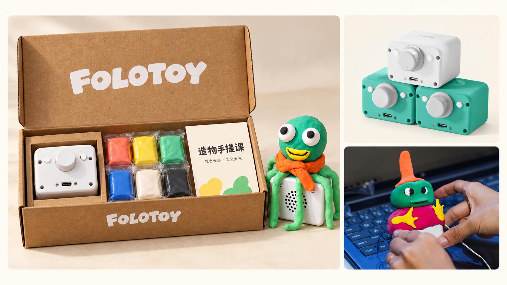

# MagicBox 多代硬件 BSP

<p align="center">
  
</p>

[English](README.md) · [架构与版本规则](docs/ARCHITECTURE.md) · [验证记录](docs/VALIDATION.md)

按“型号 + 芯片 + PCB 版本”选择硬件。同为 S3 不代表引脚、电源或器件相同，不做自动猜板。

| 配置 ID | 硬件 | SDK | 状态 |
|---|---|---|---|
| `m09-s3-hw210` | M09 / ESP32-S3 / HW2.1.0 | ESP-IDF 6.1 | 用户确认型号；原始固件使用 Arduino |
| `c5-reference-m301-hw120` | ESP32-C5 / 原配置 M301 / HW1.2.0 | ESP-IDF 6.1 | 具体产品型号待用户确认，保留参考标识 |

- `main`：BSP、最小入口、独立硬件诊断示例。
- `demo/magicbox` 分支：继承 main，加入兼容小智协议的 MagicBox 固件。目前 M09 移植有历史实机记录；不把 C5 BSP 编译通过标成 C5 小智已适配。
原 Arduino 实现请查看已归档的 [magicbox-arduino 仓库](https://github.com/FoloToy/magicbox-arduino)。本仓库保留原生 ESP-IDF 实现；历史实机记录不代表新 BSP 已完成实机验收。

## 分支

| 分支 | 用途 |
|---|---|
| `main` | BSP、最小入口和硬件诊断 |
| [`demo/magicbox`](https://github.com/FoloToy/MagicBox/tree/demo/magicbox) | 连接 Magic Server 的 MagicBox 固件 |
| [`demo/xiaozhi`](https://github.com/FoloToy/MagicBox/tree/demo/xiaozhi) | 保留固定上游小智功能，连接原小智服务 |

[分支与服务说明](docs/BRANCHES.zh_CN.md)。

## 固件下载

[MagicBox v0.1](https://github.com/FoloToy/MagicBox/releases/tag/v0.1) 使用独立的 MagicBox 版本体系，下载文件名按硬件与 MagicBox 版本命名。当前 M09 固件兼容小智协议。[升级说明](https://github.com/FoloToy/MagicBox/blob/demo/magicbox/docs/FIRMWARE_RELEASES.zh_CN.md)。

```sh
python3 tools/build.py --list
source /path/to/esp-idf-v6.1/export.sh
python tools/build.py --board m09-s3-hw210 --app baseline
python tools/build.py --board m09-s3-hw210 --app hardware-demo
# C5 使用同一 ESP-IDF 6.1 环境：
python tools/build.py --board c5-reference-m301-hw120 --app baseline
python tools/build.py --board c5-reference-m301-hw120 --app hardware-demo
```

构建不会刷机；产物按配置 ID 分目录，保留 SHA256、SDK 和芯片信息。未知版本、缺少硬件配置、芯片不匹配会被拒绝。后续增加另一块 S3 板时，新建配置和引脚头文件，不能覆盖 M09。旧量产设备烧录前必须核对分区并保留原厂应用、身份和配置。

[C5 硬件与来源说明](boards/c5-reference-m301-hw120/README.zh_CN.md)。
